<div align="center">

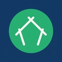

# Enhorabuena

**Inventory, point of sale and online catalog for a Betterware reseller.**

*Scan a product's barcode with the phone, and it shows up in a public catalog with the official photos, description and price. Customers order over WhatsApp.*

<a href="https://enhorabuena.vercel.app"></a>

[](https://nextjs.org)
[](https://www.typescriptlang.org)
[](https://www.prisma.io)
[](https://neon.tech)
[](https://tailwindcss.com)
[](https://web.dev/progressive-web-apps/)

<br>

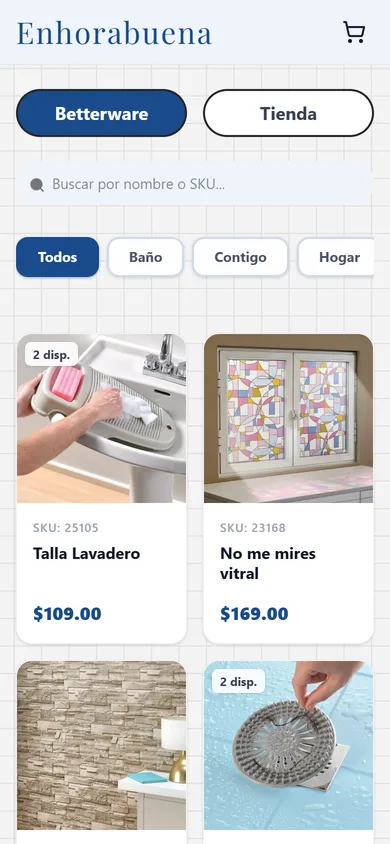&nbsp;
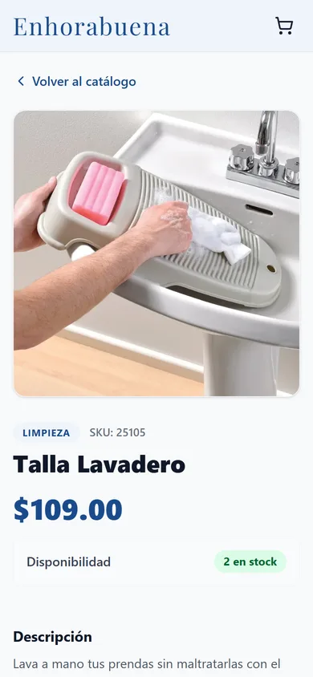&nbsp;
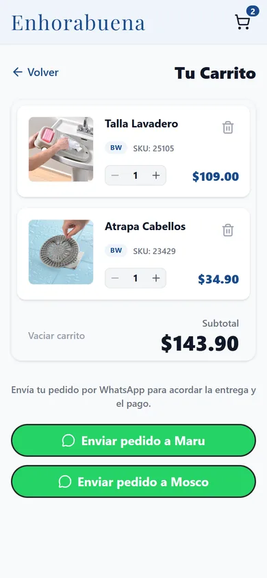&nbsp;
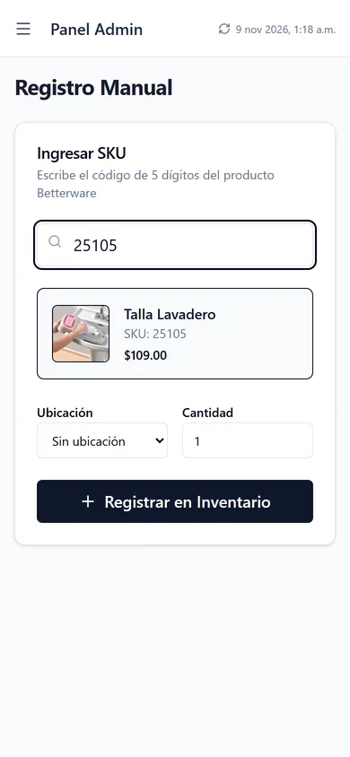

</div>

---

## What is Enhorabuena?

The sellers behind Enhorabuena sell Betterware products by catalog and keep a stock of extra items
(returns, extra purchases, gifts). They used to track it in a spreadsheet and send product names
without photos over WhatsApp, deleting the row after each sale.

Enhorabuena replaces that with two connected parts:

- 🛍️ **A public catalog** where customers browse what is actually in stock, with the official
  Betterware photos, description and price, add products to a cart and send the order over WhatsApp.
- 🧾 **An admin panel** (mobile first) to register stock by scanning barcodes, record sales, track
  where each unit is stored and see income per month.

Product data comes from Betterware's **public catalog** (~3,900 products), synced every day, so only
the SKU has to be typed or scanned. Products that are not from Betterware live in a separate
**Personal Store** with their own photos and stock. The interface is in Spanish.

---

## 📸 Screenshots

### Public catalog

<div align="center">

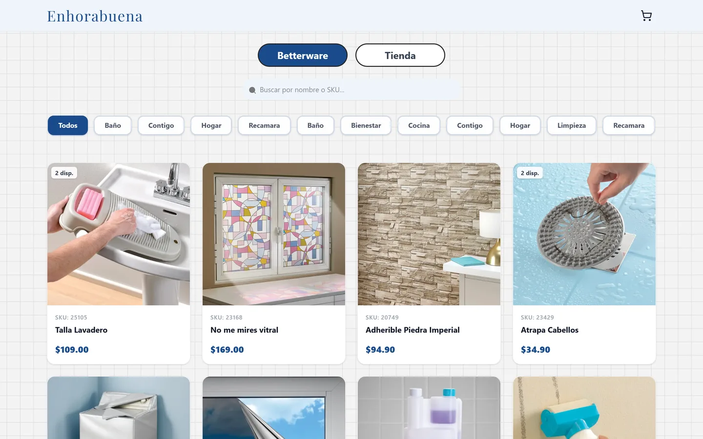

<br><br>

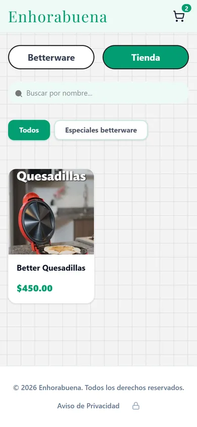

</div>

### Admin panel

<sub>Admin screenshots come from a local copy with demo stock; the products are real Betterware
catalog entries, the quantities and sales are not.</sub>

<div align="center">

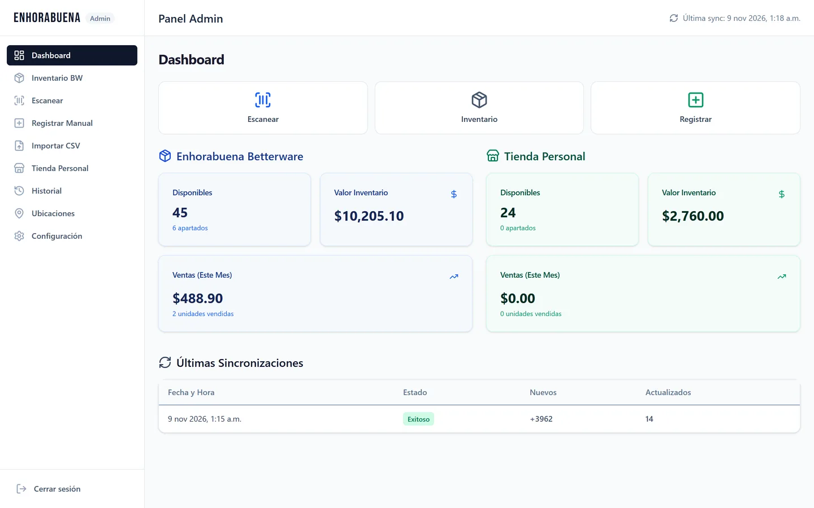&nbsp;
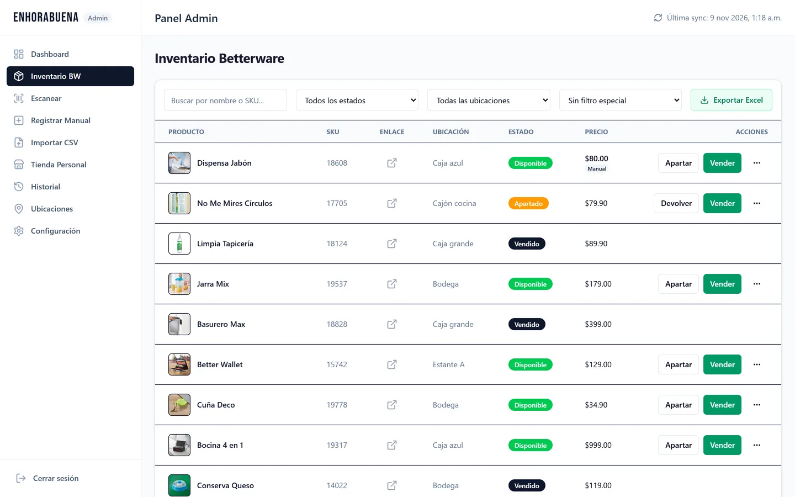

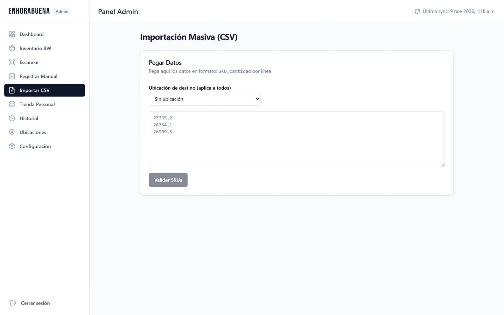&nbsp;
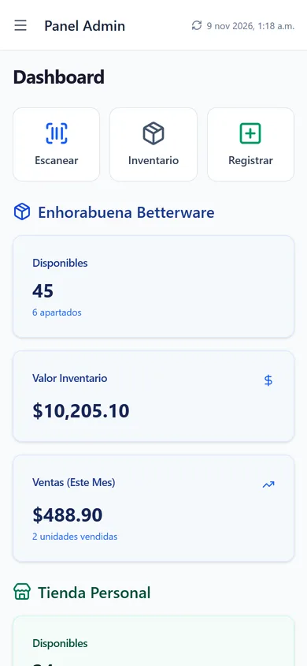&nbsp;
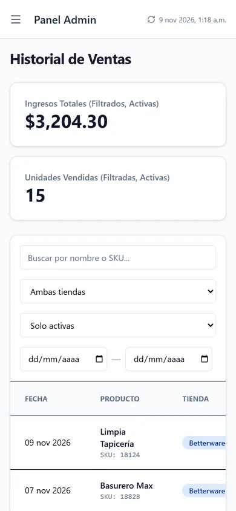

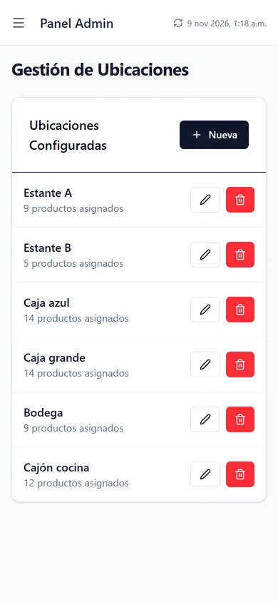

</div>

---

## ✨ Features

### Public catalog
- 🗂️ Two tabs: **Betterware** (blue) and **Personal Store** (green), each with search and category chips.
- 🖼️ Product pages with an **image carousel** (swipe on mobile), sanitized description, category,
  SKU and available stock.
- 🛒 **Cart** stored in the browser and **WhatsApp checkout**: the order is sent as a message to one
  of the two sellers to agree on delivery and payment. No online payments.
- 📱 **PWA**: installable on Android and iOS.
- 🔒 Privacy notice page.

### Betterware inventory
- 🔄 **Automatic sync** with the Betterware catalog (daily Vercel Cron): prices, images,
  descriptions and availability stay current; new products and deactivations are logged.
- 📷 **Barcode scanner** with the phone camera (`html5-qrcode`), with a beep and vibration on each
  read, for very fast registration and sales.
- ⌨️ **Manual registration** by 5-digit SKU with an instant preview, location and quantity.
- 📥 **Bulk import** by pasting `SKU,quantity` lines, validated before saving.
- 🏷️ Every physical unit has a **state**: available, reserved, sold or withdrawn, plus notes.
- 💲 **Custom prices** that override the catalog price, and a "red price" filter to double check.
- 📍 **Storage locations** (shelves, boxes…) that can be created, renamed and deleted, with the number of units in each.
- 📊 **Excel export** of the inventory.

### Personal store
- ➕ Own products with photos uploaded to **Cloudinary**, description, price, category and stock.
- 📦 Stock, reserved and sold counters, with categories created on the fly.

### Sales and reports
- 💰 **Dashboard** with available units, inventory value and this month's sales for each store,
  plus the latest catalog syncs.
- 🧾 **Sales history** for both stores with filters by store, state and date range, total income and
  units sold.
- ↩️ **Reversible sales**: a sale registered by mistake can be undone and the unit goes back to stock.

### Security
- 🔐 Admin login with **Auth.js (NextAuth v5)** and bcrypt; admin routes and APIs are protected on the server.
- ✅ Strict **Zod** validation on every API route and **DOMPurify** for the HTML that comes from Betterware.
- ⏰ The sync endpoint is protected with a `CRON_SECRET`.

---

## 🛠️ Tech Stack

| Layer | Technology |
| :--- | :--- |
| **Framework** | Next.js 16 (App Router, Route Handlers), React 19, TypeScript |
| **Styling** | Tailwind CSS 4, Framer Motion, Lucide icons |
| **Database** | PostgreSQL on [Neon](https://neon.tech) (serverless) |
| **ORM** | Prisma 5 |
| **Auth** | Auth.js / NextAuth v5 (Credentials) + bcrypt |
| **Validation** | Zod, DOMPurify |
| **State** | Zustand (cart) |
| **Scanner** | `html5-qrcode` |
| **Images** | Betterware CDN (catalog), Cloudinary (personal store) |
| **Excel** | ExcelJS |
| **Hosting** | Vercel + Vercel Cron |
| **PWA** | `next-pwa` |

---

## 🏗️ Project Structure

```
src/
├── app/
│   ├── (public)/                 # Public catalog
│   │   ├── page.tsx              #   Betterware / Personal Store tabs
│   │   ├── producto/bw/[sku]/    #   Betterware product page
│   │   ├── producto/tp/[id]/     #   Personal store product page
│   │   ├── carrito/              #   Cart + WhatsApp checkout
│   │   └── privacidad/           #   Privacy notice
│   ├── admin/
│   │   ├── login/
│   │   └── (dashboard)/          # escanear, registrar, importar, inventario,
│   │                             # tienda, historial, ubicaciones, configuracion
│   └── api/                      # sync, inventory, products, sales, custom-products,
│                                 # locations, config, upload, auth
├── components/
│   ├── catalog/                  # CatalogView, ProductCard, ImageCarousel, CartView…
│   ├── admin/                    # AdminShell, Sidebar, Header
│   └── ui/                       # Button, Card, Modal, Select, Badge…
prisma/
├── schema.prisma                 # CatalogProduct, InventoryUnit, Location, CustomProduct,
│                                 # CustomSaleRecord, AdminUser, SyncLog, AppConfig
└── seed.ts                       # Admin user and initial config
```

---

## 🚀 Getting Started

### Prerequisites
- Node.js 20+
- A PostgreSQL database (Neon recommended)
- A Cloudinary account for the personal store images

### Setup

```bash
git clone https://github.com/NotJcao17/enhorabuena.git
cd enhorabuena
npm install
cp .env.example .env
```

| Variable | Purpose |
| :--- | :--- |
| `DATABASE_URL` | PostgreSQL connection string |
| `NEXTAUTH_URL` | App URL, `http://localhost:3000` locally |
| `NEXTAUTH_SECRET` | Session secret |
| `ADMIN_USERNAME`, `ADMIN_PASSWORD`, `ADMIN_NAME` | Admin user, used only by the seed |
| `CRON_SECRET` | Protects the catalog sync endpoint |
| `CLOUDINARY_CLOUD_NAME`, `CLOUDINARY_API_KEY`, `CLOUDINARY_API_SECRET` | Personal store images |

```bash
npx prisma db push      # create the schema
npx prisma db seed      # admin user and initial config
npm run dev             # http://localhost:3000
```

### First catalog sync

The catalog fills itself once a day on Vercel. To load it locally, call the sync endpoint once:

```bash
curl -H "Authorization: Bearer $CRON_SECRET" http://localhost:3000/api/sync/catalog
```

---

## ⚖️ Disclaimer

Enhorabuena is an independent tool for resellers. It is **not an official Betterware store** and
it only reads Betterware's public catalog; product names, photos and trademarks belong to Betterware.

---

<div align="center">
  Created by <b>Juan Carlos Orozco Nieto</b>
</div>
